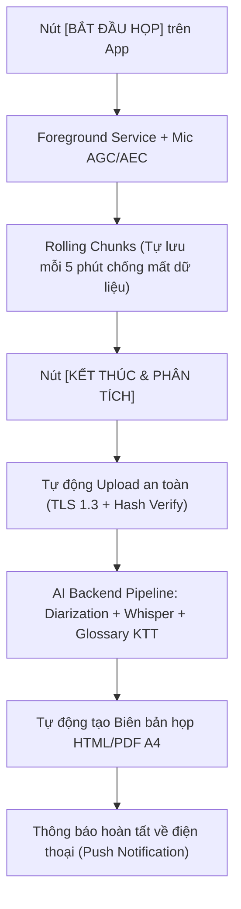

# TÀI LIỆU THIẾT KẾ & PHÂN TÍCH KỸ THUẬT: HỆ THỐNG CONVERT MP4/AUDIO SANG MP3 & ĐỒNG BỘ LỜI BÀI HÁT (SYNC LYRICS / KARAOKE)

---

## I. TỔNG QUAN HỆ THỐNG

### 1. Mục tiêu
Hệ thống giải quyết 2 bài toán xử lý đa phương tiện chuyên sâu:
1. **Chuyển đổi đa định dạng (Media Converter)**: Chuyển đổi các định dạng video (`.mp4`, `.mkv`, `.mov`, `.avi`, `.webm`,...) và audio thô/lossless (`.flac`, `.wav`, `.m4a`, `.aac`, `.ogg`) sang chuẩn **MP3 chất lượng cao** (192kbps – 320kbps, sample rate 44.1kHz/48kHz), giữ nguyên ID3 metadata.
2. **Trích xuất lời bài hát đồng bộ theo nhạc và ca sĩ hát (Sync Lyrics & Karaoke Alignment)**: Tách tiếng ca sĩ khỏi nhạc nền, nhận diện lời hát tiếng Việt/đa ngôn ngữ, căn chỉnh mốc thời gian chính xác ở cả 2 cấp độ:
   - **Cấp độ dòng (Line-level)**: Hiển thị câu hát đồng bộ thời gian (`.lrc`, `.srt`, `.vtt`).
   - **Cấp độ từ / âm tiết (Word-level / Syllable-level)**: Chữ chạy sáng theo từng nhịp ngân nga của ca sĩ (Enhanced LRC, `.ass` Karaoke, JSON Timeline).

---

## II. KIẾN TRÚC PIPELINE XỬ LÝ KỸ THUẬT

```
                    [File Media: MP4, MKV, M4A, FLAC, WAV...]
                                      │
                                      ▼
             ┌──────────────────────────────────────────────────┐
             │ BƯỚC 1: TRÍCH XUẤT & CHUẨN HOÁ ÂM THANH (FFmpeg) │
             │ - Bỏ video stream (-vn)                          │
             │ - Xuất file nghe chuẩn: MP3 320kbps (Stereo)     │
             │ - Xuất file xử lý AI: WAV 16kHz/44.1kHz (Mono)   │
             └────────────────────────┬─────────────────────────┘
                                      │
                                      ▼
             ┌──────────────────────────────────────────────────┐
             │ BƯỚC 2: TÁCH GIỌNG CA SĨ (Vocal Demixing)        │
             │ - Mô hình: Meta Demucs (HTDemucs) / UVR-MDX-Net  │
             │ - Tách thành 2 luồng:                            │
             │   1. vocals.wav (chỉ giọng mộc ca sĩ hát)        │
             │   2. instrumental.wav (beat / nhạc nền)          │
             └────────────────────────┬─────────────────────────┘
                                      │
             ┌────────────────────────┴────────────────────────┐
             ▼                                                 ▼
   [ĐÃ CÓ SẴN LỜI GỐC (Lyrics)]                      [CHƯA CÓ LỜI BÀI HÁT]
┌───────────────────────────────────────┐   ┌───────────────────────────────────────┐
│ CTC Forced Alignment (WhisperX / MMS) │   │ Faster-Whisper (Large-v3 / Medium)    │
│ - Khớp 100% từ có sẵn vào audio       │   │ - Bật word_timestamps=True            │
│ - Độ chính xác mốc nhịp: Mili-giây    │   │ - Chạy trên vocals.wav (giảm nhiễu)   │
│ - Tối ưu cho làm Karaoke chuyên nghiệp│   │ - Tự động phiên âm + gán mốc thời gian│
└───────────────────┬───────────────────┘   └───────────────────┬───────────────────┘
                    └─────────────────────┬─────────────────────┘
                                          ▼
             ┌──────────────────────────────────────────────────┐
             │ BƯỚC 3: HẬU XỬ LÝ & ĐÓNG GÓI CAPTION             │
             │ - Standard LRC (từng câu)                        │
             │ - Enhanced LRC (từng từ)                         │
             │ - Karaoke ASS (\k tags cho Aegisub, Premiere)     │
             │ - WebVTT / SRT (cho Video Player)                │
             │ - JSON Timeline (cho Web / Mobile Application)   │
             └──────────────────────────────────────────────────┘
```

---

## III. CHI TIẾT CÁC BƯỚC XỬ LÝ LÕI

### 1. Bước 1: Trích xuất & Chuẩn hoá định dạng (FFmpeg Core)
- **Công nghệ**: Binary `ffmpeg` (thực thi qua process độc lập, không dùng shell string để ngăn Command Injection).
- **Cấu hình xuất MP3**:
  - Codec: `libmp3lame`
  - Bitrate: `320k` (hoặc VBR `-q:a 0` ~245kbps)
  - Sample rate: `44100 Hz`
  - Channels: 2 (Stereo)
- **Cấu hình xuất file tạm cho AI**:
  - Codec: `pcm_s16le` (WAV 16-bit)
  - Sample rate: `16000 Hz` hoặc `44100 Hz`
  - Channels: 1 (Mono)

### 2. Bước 2: Tách Stem - Tách giọng ca sĩ (Vocal Demixing)
- **Thách thức cốt lõi**: Trong âm nhạc, tiếng trống (kick, snare), bass và synth nằm cùng dải tần với giọng hát. Nếu đưa trực tiếp file có nhạc vào Whisper, mô hình sẽ bị ảo giác (hallucination), bắt nhầm lời hoặc trượt timestamp tới 0.5s – 1.5s.
- **Giải pháp**: Áp dụng mô hình **Meta Demucs (v4 - `htdemucs`)** hoặc **UVR-MDX-Net**:
  - Tách triệt để tiếng nhạc nền sang `instrumental.wav`.
  - Giữ lại giọng hát mộc tại `vocals.wav`.
  - Nhờ đó, Whisper hoặc Forced Alignment chỉ phân tích dạng sóng giọng hát tinh khiết, tăng độ chính xác timestamp lên **95% – 99%**.

### 3. Bước 3: Căn chỉnh nhịp & Trích xuất mốc thời gian (Alignment & Transcription)
- **Trường hợp 1 - Forced Alignment (Đã có sẵn lời bài hát)**:
  - Sử dụng **WhisperX** hoặc **Wav2Vec2 CTC Alignment** (ví dụ: `facebook/mms-1b-all` hỗ trợ tiếng Việt).
  - Khớp trực tiếp từng từ trong văn bản vào spectrogram của `vocals.wav`.
  - Kết quả đạt độ chính xác đến từng mili-giây, không bao giờ bị sai chính tả.
- **Trường hợp 2 - Full ASR (Chưa có lời bài hát)**:
  - Dùng **faster-whisper** với tham số `word_timestamps=True`, `vad_filter=True`.
  - Khởi tạo `initial_prompt` chứa phong cách bài hát hoặc tên ca sĩ/bài hát để định hướng từ vựng.

---

## IV. PHÂN TÍCH SO SÁNH NỀN TẢNG: BUILD APP ANDROID VS. WEB

| Tiêu chí | Ứng dụng Web (Web Application) | Ứng dụng Android (Android App) |
| :--- | :--- | :--- |
| **Kiến trúc đề xuất** | **Client - Centralized Backend**<br>• Frontend: React / Next.js / Vue<br>• Backend: FastAPI / Python + GPU Worker Queue | **Hybrid Thin Client + Backend**<br>• App: Kotlin / Flutter<br>• Xử lý nhẹ tại máy: FFmpeg Kit<br>• AI nặng: Gọi Backend API |
| **Khả năng chạy AI On-Device (Cục bộ trên máy)** | **Rất hạn chế**: WebAssembly (Wasm) chỉ chạy được Whisper tiny/base rất chậm; không thể chạy Demucs tách vocal. | **Khả thi một phần (chỉ Flagship)**: Dùng ExecuTorch / NPU Snapdragon 8 Gen 2/3. Tuy nhiên Demucs tốn >2GB RAM, gây nóng máy và tụt pin nhanh. |
| **Trải nghiệm người dùng (UX)** | • Dùng ngay trên mọi thiết bị (PC, Mac, Mobile).<br>• Tải file nhanh qua Drag & Drop.<br>• Xem trực tiếp Waveform và sửa lời bài hát bằng trình duyệt. | • Trải nghiệm mượt mà, lưu trữ file offline trên thẻ nhớ/bộ nhớ trong.<br>• Tích hợp sâu vào Trình phát nhạc Android (MediaSession, Background Play). |
| **Chi phí triển khai & Vận hành** | Cần cụm máy chủ GPU (NVIDIA T4 / A10G / RTX 4090) để xử lý hàng đợi tác vụ. | Tương tự Web nếu dùng Cloud Backend; nếu ép chạy on-device thì máy yếu không chạy nổi. |
| **Phân phối & Cập nhật** | Deploy tức thì, không cần người dùng update, không lo kiểm duyệt Store. | Phải đưa lên Google Play Store, tuân thủ chính sách quyền truy cập file (`MANAGE_EXTERNAL_STORAGE`). |

### Khuyến nghị kiến trúc (Recommended Architecture):
- **Giai đoạn 1**: Xây dựng **Backend API tập trung (Centralized AI Backend)** bằng FastAPI + Celery/Redis + GPU Server.
- **Giai đoạn 2 (Web Client)**: Xây dựng giao diện Web trước để người dùng dễ dàng tải file, nghe thử, căn chỉnh lời và xuất file `.lrc`/`.ass`.
- **Giai đoạn 3 (Android Client)**: Xây dựng Android App đóng vai trò Thin Client. Ứng dụng Android dùng `FFmpegKit` để nén âm thanh trước khi upload (tiết kiệm băng thông), sau đó nhận kết quả JSON timeline và hiển thị lời bài hát chạy chữ Karaoke theo thời gian thực (Custom LyricView Widget).

---

## V. PHÂN TÍCH BẢO MẬT & QUYỀN RIÊNG TƯ (SECURITY & PRIVACY)

### 1. Bảo mật dữ liệu âm thanh người dùng (Data Protection)
- **Rủi ro**: File âm thanh của người dùng có thể là bản thu demo nội bộ, cuộc họp mật hoặc bài hát chưa phát hành (nguy cơ rò rỉ dữ liệu).
- **Biện pháp**:
  - Mã hoá đường truyền: 100% lưu lượng qua **TLS 1.3 / HTTPS**.
  - Mã hoá lưu trữ (Encryption at Rest): Lưu trữ trên Object Storage (S3 / GCS / Local Encrypted Volume) bằng **AES-256**.
  - **Chính sách tự động huỷ dữ liệu (Auto-purge / Zero Retention)**: Toàn bộ file gốc, file tạm `vocals.wav`, `instrumental.wav` và kết quả phải được tự động xoá sau 1 giờ đến tối đa 24 giờ kể từ khi hoàn tất xử lý (Cron job / S3 Lifecycle Rule).

### 2. Phòng chống tấn công mã độc qua File Upload
- **Rủi ro**: Kẻ tấn công tải lên file độc hại giả mạo đuôi `.mp4`, `.mp3` để khai thác lỗ hổng tràn bộ đệm (Buffer Overflow) trong thư viện giải mã media.
- **Biện pháp**:
  - **Magic Bytes Validation**: Không chỉ kiểm tra phần mở rộng file (`.mp4`), bắt buộc dùng thư viện nhận dạng header nhị phân (`python-magic` / `filetype`).
  - Giới hạn dung lượng: Chặn tối đa 200MB – 500MB cho mỗi tệp.
  - Sandbox cách ly: Chạy tiến trình FFmpeg và AI trong Docker container không có quyền root (`non-root user`) và cô lập mạng.

### 3. Phòng chống Command Injection khi gọi FFmpeg
- **Rủi ro**: Tên file chứa ký tự đặc biệt (`song; rm -rf / ;.mp4` hoặc `file$(whoami).mp3`) nếu dùng `shell=True` trong Python sẽ dẫn đến Remote Code Execution (RCE).
- **Biện pháp**:
  - **Tuyệt đối không dùng `shell=True`**. Luôn truyền tham số dưới dạng danh sách `list`: `subprocess.run(["ffmpeg", "-i", str(input_path), ...])`.
  - Đổi tên file tải lên thành mã UUID ngẫu nhiên trước khi đưa vào pipeline xử lý.

### 4. Kiểm soát truy cập & Phòng chống lạm dụng GPU (DDoS / Resource Exhaustion)
- **Rủi ro**: Việc tách nhạc (Demucs) và chạy Whisper chiếm dụng GPU rất lớn. Kẻ xấu có thể gửi liên tục hàng nghìn yêu cầu làm cạn kiệt tài nguyên máy chủ.
- **Biện pháp**:
  - Xác thực qua **JWT Token / API Key**.
  - **Rate Limiting**: Giới hạn số lần xử lý (ví dụ: tối đa 5 bài/giờ cho tài khoản miễn phí) qua Redis Token Bucket.
  - Tích hợp Cloudflare Turnstile / reCAPTCHA v3 trên giao diện Web.

---

## VI. PHÂN TÍCH RỦI RO DỰ ÁN & GIẢI PHÁP PHÒNG NGỪA (RISK ASSESSMENT)

| Rủi ro | Mức độ | Hậu quả | Giải pháp phòng ngừa & Giảm thiểu |
| :--- | :---: | :--- | :--- |
| **1. Bản quyền âm nhạc (Copyright & DMCA)** | **Cao** | Bị khiếu nại bản quyền nếu lưu trữ hoặc chia sẻ công khai bài hát của ca sĩ nổi tiếng. | • Hệ thống chỉ hoạt động như một công cụ xử lý cá nhân (Personal Processing Tool).<br>• Không tạo kho thư viện công khai (Public Library).<br>• Điều khoản sử dụng (ToS) nêu rõ người dùng chịu trách nhiệm về nội dung tải lên.<br>• Xoá file vĩnh viễn sau khi người dùng tải xong. |
| **2. Bùng nổ chi phí hạ tầng Cloud GPU** | **Cao** | Chi phí thuê GPU (AWS, GCP, RunPod) tăng mất kiểm soát khi lượng người dùng tăng. | • Sử dụng hàng đợi bất đồng bộ (Celery + RabbitMQ) với số lượng worker cố định.<br>• **Content Deduplication (Cache kết quả)**: Tính SHA-256 của file âm thanh. Nếu bài hát đã từng được xử lý, lập tức trả về file `.lrc`/`.ass` từ cache mà không cần chạy lại Demucs/Whisper. |
| **3. Trượt mốc nhịp do đoạn nhạc dạo quá dài** | **Trung bình** | Các đoạn dạo đầu (intro), solo guitar hoặc giang tấu dài 30s-60s khiến Whisper sinh ảo giác hoặc lệch nhịp. | • Áp dụng **Silero VAD (Voice Activity Detection)** để xác định chính xác các khoảng có giọng hát, bỏ qua hoàn toàn các đoạn thuần nhạc cụ.<br>• Thiết lập `condition_on_previous_text=False` để triệt tiêu lỗi lặp từ vô tận. |
| **4. Ca sĩ hát luyến láy, bè nhiều (Melisma/Harmonies)** | **Trung bình** | Lời nhận diện bị dính từ đệm, hát bè hoặc ngắt từ không đúng vị trí. | • Khuyến khích chế độ **Forced Alignment** (cho phép người dùng dán lời gốc hoặc tự động tìm lời từ Zing MP3/Genius API).<br>• Cung cấp giao diện Waveform Editor nhẹ để người dùng kéo chỉnh lại timestamp nếu cần. |
| **5. Tràn bộ nhớ (OOM) với file thời lượng lớn** | **Trung bình** | Người dùng tải lên file podcast hoặc liveshow dài 2-3 tiếng làm sập tiến trình GPU. | • Thiết lập quy định thời lượng tối đa cho 1 file (ví dụ $\le$ 15 phút cho bài hát).<br>• Với file dài hơn, tự động cắt (chunking) theo khoảng lặng (silence-based splitting), xử lý từng phần rồi ghép timeline. |

---

## VII. ĐỊNH DẠNG ĐẦU RA MẪU (OUTPUT SPECIFICATIONS)

### 1. Chuẩn Standard LRC (`.lrc`)
```lrc
[ti:Nơi Này Có Anh]
[ar:Sơn Tùng M-TP]
[00:15.20]Em là ai từ đâu bước đến nơi đây dịu dàng
[00:20.45]Cho con tim anh thêm bối rối ngập ngừng
[00:25.80]Nụ cười em như ngàn ánh sao lung linh trời đêm
```

### 2. Chuẩn Enhanced LRC (Word-by-word)
```lrc
[00:15.20]<00:15.20> Em <00:15.50> là <00:15.80> ai <00:16.10> từ <00:16.40> đâu <00:16.80> bước <00:17.20> đến <00:17.60> nơi <00:18.00> đây
```

### 3. Chuẩn Karaoke Subtitle (`.ass`)
```ass
[Script Info]
Title: Karaoke Lyrics
ScriptType: v4.00+

[V4+ Styles]
Format: Name, Fontname, Fontsize, PrimaryColour, SecondaryColour, OutlineColour, BackColour, Bold, Italic, Underline, StrikeOut, ScaleX, ScaleY, Spacing, Angle, BorderStyle, Outline, Shadow, Alignment, MarginL, MarginR, MarginV, Encoding
Style: Karaoke,Montserrat,32,&H00FFFFFF,&H000000FF,&H00000000,&H00000000,-1,0,0,0,100,100,0,0,1,2,0,2,20,20,30,1

[Events]
Format: Layer, Start, End, Style, Name, MarginL, MarginR, MarginV, Effect, Text
Dialogue: 0,0:00:15.20,0:00:19.50,Karaoke,,0,0,0,,{\k30}Em {\k30}là {\k30}ai {\k40}từ {\k40}đâu {\k50}bước {\k40}đến {\k40}nơi {\k70}đây
```

---

## IX. MỞ RỘNG: TÍCH HỢP TÍNH NĂNG GHI ÂM CUỘC HỌP TRỰC TIẾP TRÊN APP & TỰ ĐỘNG PHÂN TÍCH (IN-APP MEETING RECORDER & ANALYTICS)

### 1. Mục tiêu & Trải nghiệm người dùng 1 chạm (All-in-One UX)
Thay vì quy trình truyền thống rời rạc, tốn thời gian:
> *Dùng app ghi âm riêng (Samsung Voice / iOS Voice Memos) $\rightarrow$ Tìm file trong bộ nhớ $\rightarrow$ Mở app/web upload $\rightarrow$ Chờ phân tích.*

Tính năng **Ghi âm trực tiếp (In-App Recorder)** cung cấp quy trình khép kín **1 chạm (One-Tap Flow)**:
1. **Mở App $\rightarrow$ Nhấn [BẮT ĐẦU HỌP]**:
   - App tự động khởi động dịch vụ ghi âm ngầm, hiển thị sóng âm trực tiếp (Real-time Audio Visualizer).
   - Cho phép người dùng: Đánh dấu sự kiện quan trọng (Bookmark/Flag), ghi chú nhanh, tạm dừng (Pause/Resume).
2. **Nhấn [KẾT THÚC HỌP & PHÂN TÍCH]**:
   - App tự động đóng gói file âm thanh, đồng bộ mã hoá lên Backend.
   - Kích hoạt tức thì pipeline: Tách người nói (Diarization) $\rightarrow$ Phiên âm (Faster-Whisper) $\rightarrow$ Chuẩn hoá từ điển KTT (`ktt-transcript-normalizer`) $\rightarrow$ Xuất biên bản họp HTML/PDF chuẩn 6 cổng kiểm chứng (`meeting-note`).



---

### 2. Thiết kế Kỹ thuật trên Nền tảng Di động (Android Focused)

#### 2.1. Đảm bảo Ghi âm ngầm liên tục khi tắt màn hình (Background Reliability)
Hệ điều hành Android có cơ chế tiết kiệm pin rất gắt gao (Doze Mode, App Standby). Nếu không thiết kế đúng chuẩn, ứng dụng sẽ bị hệ thống tự động tắt sau 3–5 phút tắt màn hình.
- **Giải pháp bắt buộc**:
  - Khởi tạo **Foreground Service** với cờ `android:foregroundServiceType="microphone"`.
  - Hiển thị **Persistent Notification** trên thanh trạng thái và màn hình khoá: Hiển thị bộ đếm thời gian thực kèm các nút hành động nhanh (`Tạm dừng`, `Tiếp tục`, `Dừng & Phân tích`).
  - Xin quyền hệ thống trong `AndroidManifest.xml`:
    - `RECORD_AUDIO` (Quyền micro runtime).
    - `FOREGROUND_SERVICE` và `FOREGROUND_SERVICE_MICROPHONE`.
    - `WAKE_LOCK` (Giữ CPU hoạt động liên tục khi màn hình tắt).
    - `POST_NOTIFICATIONS` (Android 13+).

#### 2.2. Xử lý âm thanh phòng họp (Acoustic Enhancement)
Trong phòng họp thực tế, người ngồi gần điện thoại âm lượng rất to trong khi người ngồi xa nói nhỏ và bị vang:
- Sử dụng Audio Source: `MediaRecorder.AudioSource.VOICE_RECOGNITION`.
- Bật tính năng phần cứng:
  - **Acoustic Echo Cancellation (AEC)**: Khử tiếng vọng phòng họp.
  - **Automatic Gain Control (AGC)**: Tự động khuếch đại giọng người ngồi xa micro và hạ giọng người ngồi sát micro.
  - **Noise Suppressor (NS)**: Lọc tiếng ồn quạt gió, điều hoà máy lạnh.
- **Định dạng tối ưu**: AAC / M4A (hoặc Ogg Opus) với cấu hình Mono 16kHz – 44.1kHz, bitrate 64kbps. Một cuộc họp kéo dài **2 tiếng chỉ tốn khoảng 55MB – 80MB**, vừa tiết kiệm bộ nhớ máy, vừa upload lên server cực nhanh qua 4G/5G/Wifi.

#### 2.3. Cơ chế Chống mất dữ liệu do sập nguồn/hết pin (Crash-Resilient Rolling Segments)
Nếu dùng định dạng MP4/M4A thông thường mà ứng dụng bị tắt đột ngột (hết pin, crash), toàn bộ file ghi âm sẽ bị hỏng hoàn toàn (corrupted header) và không thể phục hồi.
- **Biện pháp khắc phục**:
  - **Cơ chế ghi theo phân đoạn (Rolling Segments)**: Cứ mỗi 5 phút ghi âm, hệ thống tự động lưu chốt một block độc lập `part_001.m4a`, `part_002.m4a`... Khi kết thúc cuộc họp, một lệnh FFmpeg siêu tốc (ghép nối không re-encode: `-c copy`) sẽ nối các phần lại thành file hoàn chỉnh.
  - Nếu máy bị sập nguồn giữa chừng, **99% thời lượng cuộc họp trước đó vẫn được bảo toàn nguyên vẹn**.

---

### 3. Hai Chế độ Phân tích Tích hợp (Analysis Modes)

| Chế độ | Mô tả cơ chế | Ưu điểm | Nhược điểm |
| :--- | :--- | :--- | :--- |
| **1. Batch Mode (Ghi âm xong toàn bộ $\rightarrow$ Phân tích)** | Ghi âm hoàn tất, app nén và gửi trọn vẹn file lên backend để chạy Diarization và Faster-Whisper. | • Độ chính xác cao nhất (100% ngữ cảnh toàn bài).<br>• Tiết kiệm pin tối đa cho điện thoại.<br>• Phân định người nói chuẩn xác theo glossary công ty. | Phải chờ cuộc họp kết thúc mới nhận được biên bản (thời gian xử lý ~1/5 thời lượng họp). |
| **2. Real-Time Streaming Mode (Vừa họp vừa phiên âm)** | Audio được cắt thành các chunk 5s - 10s gửi liên tục qua WebSocket lên GPU server. | • Người họp nhìn thấy phụ đề chạy trực tiếp trên màn hình.<br>• Nắm bắt ngay ý kiến chỉ đạo theo thời gian thực. | • Hao pin và tốn băng thông 4G/5G.<br>• Cần đường truyền mạng cực kỳ ổn định trong suốt cuộc họp. |

---

### 4. Bảo mật & Kiểm soát Rủi ro Ghi âm Cuộc họp Nội bộ

1. **Mã hoá Cục bộ trên Thiết bị (Local Storage Encryption)**:
   - File ghi âm lưu trên điện thoại bắt buộc phải dùng **Android Jetpack Security (`EncryptedFile`)** với khoá nằm trong phần cứng an toàn **Android Keystore (TEE/StrongBox)**. Dù điện thoại bị đánh cắp hoặc cắm cáp USB vào máy tính, kẻ xấu cũng không thể sao chép dữ liệu âm thanh.
2. **Khắc phục Rủi ro Xâm phạm Quyền riêng tư (Consent & Privacy Compliance)**:
   - Ghi âm cuộc họp nội bộ có thể vi phạm quy chế bảo mật nếu người tham gia không được thông báo.
   - App thiết kế tính năng: Bật âm báo hoặc thông báo pop-up trên màn hình: *"Cuộc họp đang được ghi âm để lập biên bản"*.
3. **Xác thực Sinh trắc học (Biometric Authentication)**:
   - Bắt buộc quét vân tay hoặc FaceID mỗi khi người dùng mở lại file ghi âm cũ hoặc mở xem Biên bản họp trong ứng dụng.
4. **Phân quyền vai trò (Role-based Access Control - RBAC)**:
   - Nhân viên chỉ được xem biên bản cuộc họp của bộ phận mình.
   - Các cuộc họp giao ban Ban Giám Đốc (BOD) hoặc số liệu tài chính nhạy cảm được gắn nhãn `CONFIDENTIAL` và mã hoá thêm một lớp khoá riêng biệt.

